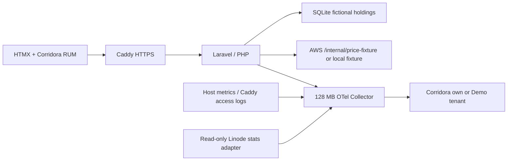

# Field Notes — Corridora portfolio sample

Published 2026-10-11 · Updated 2026-10-11

A fictional holdings and valuation app using **Laravel 12, PHP 8.4, HTMX 2,
SQLite and OpenTelemetry**. Run it locally or on one $5/month Akamai Cloud
Shared CPU VM. There are no brokerage accounts, real prices or paid APIs.

Three seeded positions produce a $1,105.50 valuation. “Revalue portfolio” makes
a traced request; “Healthy control” runs the same data through the healthy path.
HTMX loads the holdings fragment, and the OpenTelemetry browser API parents a
manual action span to Corridora RUM's fetch CLIENT span. Laravel extracts its
W3C context before starting the SERVER span, then adds SQLite and outbound HTTP
children. Every response from the API is marked `no-store`.



## Quick start

Requires PHP 8.3+ with PDO SQLite, mbstring, DOM and cURL, Python 3.10+, and
Node.js 22+. PHP 8.4 is the deployment runtime. Composer 2 and matching Chromium
are downloaded by setup if missing, into `.tools` and Playwright's cache
respectively. Linux contributors may need `npx playwright install-deps chromium`
with their normal package-manager permissions. `./setup --help` needs only Python.

```sh
./setup
```

The wizard prompts, installs locked dependencies, builds local HTMX/browser
assets, starts the localhost app, verifies a real browser journey and prints
`http://127.0.0.1:4105`. Credentials are optional for a local first run. No data
exports until a backend key is configured; browser RUM needs its own visible key.
See [Set up Corridora](docs/corridora-setup.md) for every prompt, Demo routing,
trace verification and troubleshooting.

Repeatable commands:

```sh
./setup configure
./setup deploy                    # local installs/builds; cloud shows plan
./setup deploy --plan
./setup deploy --apply            # cloud: real resources and SSH deployment
./setup run                       # local foreground server; cloud health + URL
./setup verify                    # browser healthy → regression → recovery
./setup scenario --phase regression --duration-seconds 120
./setup scenario --phase recover --duration-seconds 600
./setup destroy                   # teardown plan
./setup destroy --apply
```

Environment variables override protected JSON config. Use
`./setup configure --non-interactive` for CI; `--config path.json` selects a JSON
input file. `--noninteractive` and `--yes` are compatibility aliases. Secrets
never belong in arguments or checked-in configuration. `.env.example` documents
inputs; setup does not execute a shell `.env` file.

## Daily incident and cross-cloud fixture

Every handler derives the UTC **14:20–14:30** daily window even if the scheduler
misses a tick. A simulated rollout changes three seeded holdings from one batch
read and price fetch to per-holding SQLite reads, sequential price fetches and
three 500 ms waits. The total remains unchanged. Both the delay and number of
calls are bounded. The control portfolio bypasses the regression. A named
override accepts an authenticated phase and integer duration of 1–600 seconds;
it expires on every request. Windows that cross UTC midnight keep their original
release and full duration. State, transitions and heartbeat persist in SQLite.
Real `service.version` is a source digest; `demo.release` identifies the simulated
change separately. Repeated fault handling emits one rollout per effective release.

`PRICE_FIXTURE_URL` can point to the AWS sample's
`/internal/price-fixture`. Empty means an instrumented deterministic local fixture.
The controlled HTTPS client forwards W3C context and an optional dedicated
`DOWNSTREAM_AUTH_TOKEN`, uses a 750 ms timeout, never follows redirects, validates
fictional fixture shape, and falls back on dependency error. Export/control
credentials never accompany this request. Fastly can call this app's public
`GET /api/fixture?slow=1`, a fixed three-position 1.5-second slow fixture, with the
same downstream tracing. There is no reverse call to Fastly, preventing recursion.

`scripts/journey.mjs` clicks real frontend controls, proves a healthy control and
recovery, and posts a successful heartbeat only after all checks pass.
When RUM is configured, the journey requires its real initialization status to
be ready before clicking controls; a blocked or failed bundle withholds success.
`scripts/scheduled.mjs` runs the journey at the first tick after 14:20 UTC, checks
the heartbeat and replays a fresh expiring override every 15 minutes when evidence
is missing. Each schedule period lasts from the configured UTC start until the
next day's start; heartbeat timestamps prevent a midnight crossing or prior-period
success from suppressing a needed replay. One Chromium process runs at a time with
a 120-second watchdog. `ENABLE_SYNTHETICS=true` deploys its optional memory-limited container.
On a 1 GB VM, measure headroom before enabling it; GitHub Actions is an alternative
that keeps Chromium off the VM. Neither a process nor a provider can guarantee a
daily browser run during outages; alert on a missing heartbeat. The daily window
still applies to real user requests independently of the runner.

## Akamai deployment and cost

The wizard uses the Linode v4 API with a scoped token, shows the account before
applying, creates an Ubuntu 24.04 `g6-nanode-1` with SSH public-key access and no
backups, records ownership immediately, adds a free Cloud Firewall restricting
SSH to your CIDR and exposing 80/443, then ships prebuilt amd64 images over SSH.
It waits for cloud-init and starts Caddy, PHP and Collector with Docker Compose.
There are no builds, package registries or database servers on the small VM.
The source hash becomes `SERVICE_VERSION` and is baked into the image.

Use an existing owned domain. Set its A record to the printed VM IP and verify
the new host's SSH fingerprint through the Cloud Manager console before trusting
it in `known_hosts`; host-key checking stays enabled. Rerun `deploy --apply`
after DNS/SSH readiness. Provisioning is resumable through ownership tags and
`.sample/inventory.json`, including a lost-create-response recovery path.
The wizard needs Docker Engine on the operator/CI machine for image builds,
`ssh`/`scp`, a TLS hostname, and an SSH key with adjacent `.pub` file.

Existing-VM mode requires its account ID and matching IP, root SSH, Ubuntu/Docker
Compose already installed, and a dedicated `/opt/corridora-portfolio` directory.
Setup refuses a mismatched directory ownership marker. It does not change an
existing VM's firewall; the operator must allow 80/443 and protect SSH. Teardown
stops only this marked deployment and retains the shared VM and files. New-VM
teardown deletes only inventory entries whose live ownership tags match, removing
the VM before the firewall. DNS, account, SSH keys and cross-cloud services remain
operator managed.

Baseline: **$5/month before tax**, assuming eligible Shared CPU pricing, low
traffic, local SQLite/files, existing domain and included transfer. No Object
Storage, Longview plan, paid CDN/EdgeWorkers, paid market data, backups, new volume
or managed database is enabled. Check current region/type availability and quote
before apply. App/Caddy/Collector have 192/64/128 MB limits. Optional browser
runner has 384 MB; total limits leave little room for the OS, so external Actions
is preferred if hosted-browser measurement is unstable. Bound logs and retained
images; inspect VM memory/disk and provider billing regularly. Stats polling is
once per 15 minutes, CPU/network work is small, and alerts are advisory.

The Collector exports application SDK traces/logs/metrics, Caddy JSON access logs
and hostmetrics. Its read-only host mount is used for Linux CPU, memory, load,
disk, filesystem and network signals. It binds OTLP to loopback on the VM and a
private Docker network; no public OTLP port exists. Native Linode `/stats` needs
a separate read-only token and adapter. This covers cloud-compute statistics;
it does not claim Akamai CDN/EdgeWorkers or Longview telemetry.

Collector file offsets and the 32-batch-per-signal export queue persist in the
dedicated `collector_state` Docker volume. Batches contain at most 32 items;
compaction reclaims drained queue files. The receiver also reads the two retained
Caddy rotations, including gzip, so a restart resumes retained logs. Deployment
explicitly restarts the Collector after transferring its new key/config and
preserves that volume. This bounds queue entries and log retention, rather than
imposing a disk byte quota: watch disk space. A full queue, the 30-second retry
limit, abrupt in-flight loss, or logs beyond retention can still lose telemetry.

## Validation

```sh
npm ci
npm run build
composer install
npm test
python3 tests/run_validation.py
# Add real RUM parentage proof using an actual distribution, without shared keys:
RUM_BUNDLE_PATH=/absolute/path/corridora-rum.js python3 tests/run_validation.py
```

The last command routes the RUM CDN request to that real bundle and captures
browser and PHP SDK OTLP locally with mock keys. It asserts manual action → RUM
CLIENT → Laravel SERVER parent IDs, not merely a synthetic trace header.
`CHROMIUM_EXECUTABLE_PATH` can select an existing compatible browser. Without a
bundle the explicit parentage test is skipped; the separate frontend symptom
journey still runs. No local validation sends data to Demo.

Validation on 2026-10-11: 12 Python setup/adapter/deployment-mock tests, 17 PHP scenario
assertions, 2 Node schedule tests, Laravel API/SDK integration, 1 real-RUM Playwright parentage test and
full regression journey passed. Observed injected route 1,547 ms and healthy
control 36 ms on this machine. Docker daemon was unavailable, so image builds,
Collector/Caddy runtime, Linode provisioning/SSH/TLS and hosted daily scheduling
remain unverified. Stored Demo telemetry requires operator keys and Corridora
UI checks; these local captures prove encoding/context, not remote retention.

Official references:
[Laravel routing](https://laravel.com/framework/docs/12.x/routing),
[PHP OTel exporters](https://opentelemetry.io/docs/languages/php/exporters/),
[Linode creation API](https://techdocs.akamai.com/linode-api/reference/post-linode-instance),
[Linode stats API](https://techdocs.akamai.com/linode-api/reference/get-linode-stats),
[Collector file storage](https://github.com/open-telemetry/opentelemetry-collector-contrib/blob/v0.137.0/extension/storage/filestorage/README.md),
[Collector filelog](https://github.com/open-telemetry/opentelemetry-collector-contrib/blob/v0.137.0/receiver/filelogreceiver/README.md),
[Shared CPU plans](https://techdocs.akamai.com/cloud-computing/docs/compute-instance-plan-types),
[Docker resource limits](https://docs.docker.com/engine/containers/resource_constraints/).
